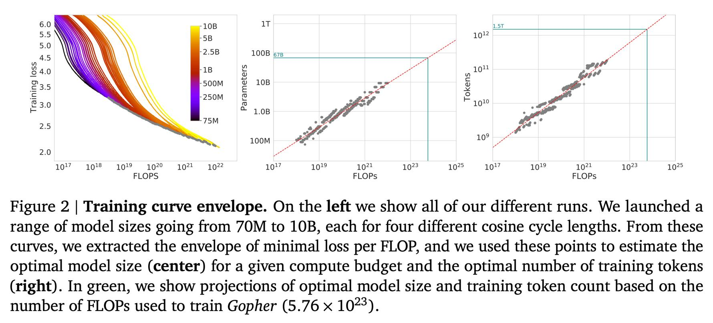
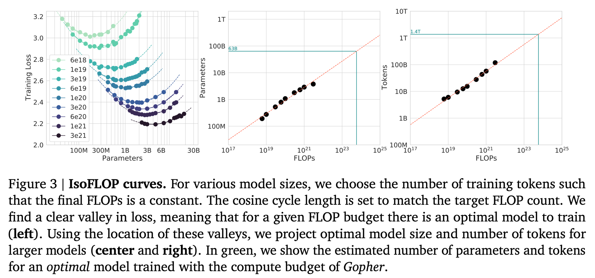
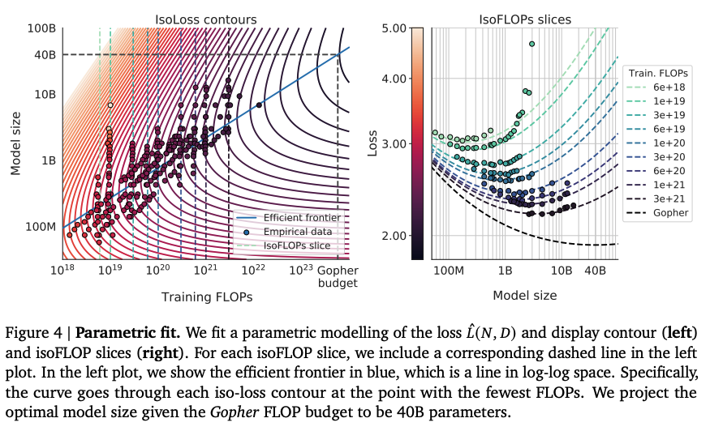
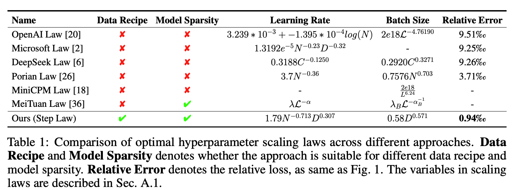
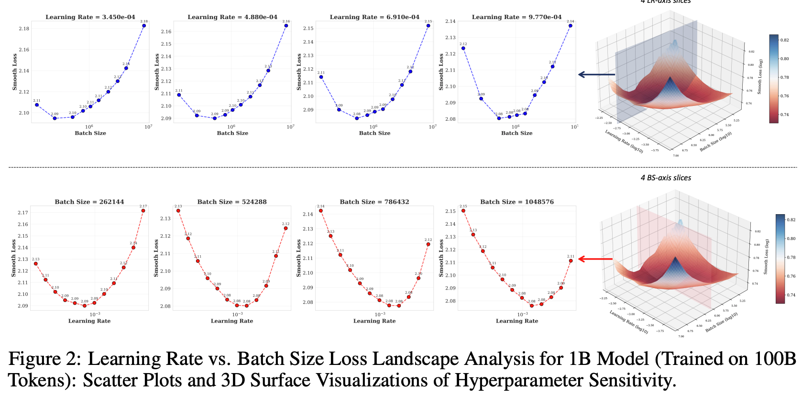
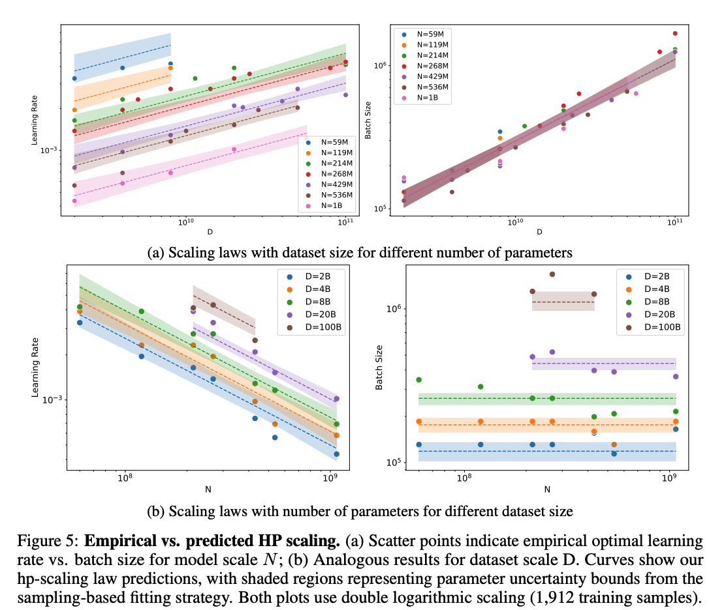
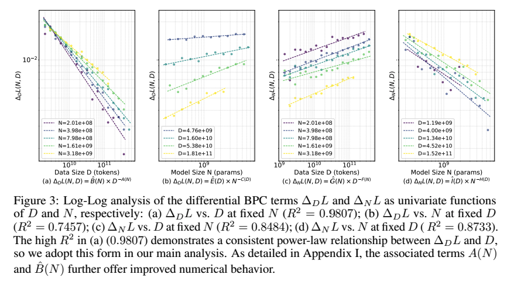
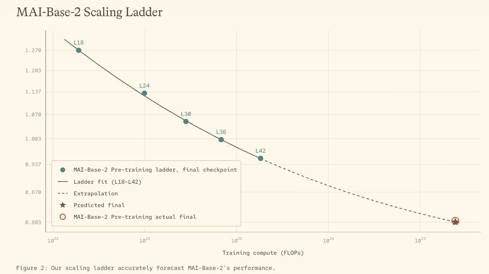

# Scaling Law: From Compute Allocation to Hyperparameter Prediction

::: {#scaling-overview}

|       **Work**       | **Date** |         **Research Question**         |             **Core Method**             |                               **Core Conclusion**                               |
| :------------------------: | :------------: | :--------------------------------: | :----------------------------------------: | :-----------------------------------------------------------------------------: |
| **Rosenfeld et al.** |    2019.09    |    How error varies jointly with $N,D$    |      Joint power-law fit across architectures / optimizers      |                     With one variable fixed, error decays as a power law in the other                     |
|    **Kaplan Law**    |    2020.01    |     How loss varies with $N,D,C$     |    Power-law fit + Critical Batch Size correction    |               $N_{\mathrm{opt}}\propto C^{0.73}$; prioritize scaling the model               |
| **Chinchilla Law** |    2022.03    |    How to split a fixed $C$ between $N,D$    |    Envelope / IsoFLOP / Parametric Fit    | $N_{\mathrm{opt}},D_{\mathrm{opt}}\propto C^{\approx0.5}$; about 20 Tokens/Param |
|   **DeepSeek Law**   |    2024.01    | Improved compute definition + how hyperparameters vary with $C$ | Non-Embedding FLOPs/token $M$ + IsoFLOP |           $M_{\mathrm{opt}}\propto C^{0.5243}$; exponent varies with data quality           |
|  **Microsoft Law**  |    2024.09    |    How the optimal LR varies with $N,D$    |       LR Sweep + quadratic fit + power-law fit       |         $\eta^*\approx1.55\times10^{-3}N^{-0.23}D^{-0.32}$ (fixed BS)         |
|     **Step Law**     |    2025.03    |       Directly predict the optimal LR and BS       | Grid Search over 3,700+ models + OLS + Bootstrap |            $\eta^*=1.79N^{-0.713}D^{0.307}$, $B^*=0.58D^{0.571}$            |
|     **Farseer**     |    2025.06    |          The interaction term between $N,D$          |       Differential Piecewise Fitting       |                       The coefficient and exponent of data scaling depend on $N$                       |
|       **MAI**       |    2026.10    |   How small-model experiments can transfer reliably to large models   | Scaling Ladder + fixed TPP + Source Scaling |                      Extrapolate MAI-Base-2's final BPB; LR/WD Scaling Law                      |

:::

## 0. What Is a Scaling Law

We first present some useful concepts and common conclusions.

The concept of a Scaling Law is this: as model size, dataset size, and compute resources increase, the training loss decreases in a predictable way. This downward trend follows a power-law curve, which appears as a straight line on a log-log plot. We can view Scaling Laws as a framework describing the relationships among compute, loss, model size, and data. Its core lies in how to allocate precious compute resources sensibly, so as to strike the best balance among the various factors.

### Notation

$N$ is the number of model parameters; $D$ is the number of training tokens; $C$ is the training compute (FLOPs); $E$ is the irreducible loss; $L,\hat L(\cdot)$ are the test loss and its prediction function (they may also refer to the training loss; the two are strongly correlated); $\epsilon$ is the generalization error.

### Where Does the Common $C\approx6ND$ Come From?

Transformer computation is almost entirely matrix multiplication, and passing one token through a weight matrix $W\in\mathbb R^{d_{\mathrm{in}}\times d_{\mathrm{out}}}$ costs $2d_{\mathrm{in}}d_{\mathrm{out}}$ FLOPs, i.e., **one multiply-add per parameter = 2 FLOPs**:

- **Forward**: $Y=XW$, $2N$ per token;
- **Backward**: two matrix multiplications of the same size, $\partial\mathcal L/\partial X=GW^\top$ (passed to the previous layer) and $\partial\mathcal L/\partial W=X^\top G$ (for updating the parameters), $4N$ per token.

$$
C\approx\underbrace{2ND}_{\text{forward}}+\underbrace{4ND}_{\text{backward}}=6ND.
$$

Of course, this certainly omits some computation:

- **Attention's $QK^\top$ and $AV$**: about $4Sd$ forward per layer per token ($S$ is the context length); its ratio to the weight term is about $S/6d$, which is not negligible for long contexts. DeepSeek's $M=72Ld^2+12LdS$ is the version that includes it.
- **Embedding, Norm, Softmax, activations, residuals**: table lookups or $O(d)$ element-wise operations, negligible compared with $O(d^2)$.
- **Optimizer updates**: once per step rather than once per token, negligible after amortization.

### Why Do We Like Power Laws?

Because after taking logarithms:

$$
\log L=\log A-\alpha\log N
$$

it becomes a straight line.

This means we can fit a straight line on smaller models and then predict the loss of larger models. **Power laws let Scaling Laws obtain their parameters through simple regression fitting and thus extrapolate; but whether the extrapolation is accurate depends on whether the power law still holds at larger scales.**

### Rosenfeld: A Joint Function of $N$ and $D$

[A Constructive Prediction of the Generalization Error Across Scales](https://arxiv.org/abs/1909.12673) (Rosenfeld et al. 2020) studied this question further. They attempted to treat the error as a joint function of model size $N$ and data size $D$, while also examining the effects of various architectures (ResNet, WRN, LSTM, Transformer) and optimizers (Adam and various SGD variants) on the error. The empirical results show that, with one of the variables fixed, the error decays as a power law in the other:

$$
\hat L(D,N)\approx\frac{A}{N^\alpha}+E_N,\qquad
\hat L(D,N)\approx\frac{B}{D^\beta}+E_D.
$$

These can be combined into a joint form:

$$
\boxed{\hat L(N,D)=E+\frac{A}{N^\alpha}+\frac{B}{D^\beta}}
$$

where $A>0,B>0,\alpha\ge0,\beta\ge0$ are scalar constants, and the value of $E$ is independent of both $N$ and $D$. It contains three terms:

|  **Term**  | **Meaning**          |
| :------------: | :---------------------- |
| $A/N^\alpha$ | Loss caused by insufficient model capacity |
| $B/D^\beta$ | Loss caused by insufficient training data |
|     $E$     | Irreducible loss             |

\clearpage

## 1. Kaplan et al.'s Scaling Laws

[Scaling Laws for Neural Language Models](https://arxiv.org/abs/2001.08361) (Kaplan et al. 2020) popularized the concept of Scaling Laws in the field of language models. They found that the relationships between the cross-entropy test loss $L$ and model size $N$ (excluding the embedding layers), dataset size $D$, and training compute $C$ all follow power laws, holding across multiple orders of magnitude. These findings are consistent with the earlier research in the previous section, but Kaplan et al. took Transformer language models as their subject and ran larger-scale empirical experiments: model sizes ranged from 768 to 1.5B non-embedding parameters (admittedly not large by today's standards), and dataset sizes from 22M to 23B tokens. All training in the paper used the same learning rate schedule: 3000 steps of linear warmup, followed by cosine decay to zero.

|     **Research Direction**     |             **Core Question**             |                 **Main Conclusion**                 |
| :------------------------: | :-----------------------------------------: | :------------------------------------------------: |
|      1. Model Scaling      |        How does parameter count $N$ affect loss?        |             $L(N)\propto N^{-0.076}$             |
|      2. Data Scaling      |        How does data size $D$ affect loss?        |             $L(D)\propto D^{-0.095}$             |
|     3. Compute Scaling     |        How does compute $C$ affect loss?        |      $L(C_{\min})\propto C_{\min}^{-0.050}$      |
|       4. Model Shape       |  How important are structural parameters such as Depth, Width, and Heads?  |          With parameter count fixed, the effect is small within a reasonable range          |
|       5. Overfitting       |      How do parameter count and data size jointly determine loss?      |        The overfitting penalty depends mainly on $N^{0.74}/D$        |
|    6. Training Dynamics    |          How does loss decrease with training steps?          | Fit $L(N,S_{\min})$ and study the Critical Batch Size |
| 7. Compute-Optimal Scaling | With FLOPs fixed, how should parameter count and token count be allocated? |  $N^*\propto C^{0.73}$, $D^*\propto C^{0.27}$  |

### The Joint Loss Function $L(N,D)$

Studying $N$ and $D$ separately is not enough, because in actual training both affect the loss simultaneously. In Section 4, Kaplan proposes:

$$
\boxed{L(N,D)=\left[\left(\frac{N_c}{N}\right)^{\alpha_N/\alpha_D}+\frac{D_c}{D}\right]^{\alpha_D}}
$$

It describes the lower bound on loss jointly determined by model capacity and data size. There are two important conclusions here:

- When $D\to\infty$, the loss is mainly determined by the parameter count $N$.
- When $N\to\infty$, the loss is mainly determined by the data size $D$.

The experiments also found that, to control the relative loss penalty caused by overfitting, the data size roughly needs to satisfy:

$$
D\propto N^{0.74}
$$

### Critical Batch Size

Batch size determines two costs of training: **the number of training steps** (wall-clock time) and **the number of tokens processed** (compute). Kaplan Law borrows the empirical relation of McCandlish et al. (2018) to characterize the tradeoff between the two, and from it defines the Critical Batch Size.

**1. The empirical relation.** When training a model to the same loss, there is an approximately fixed tradeoff between the number of training steps and the number of tokens processed:

$$
\boxed{\left(\frac{S}{S_{\min}}-1\right)\left(\frac{E}{E_{\min}}-1\right)=1}
$$

where $S$ is the number of training steps needed to reach the target loss, and $S_{\min}$ is the theoretical minimum number of steps (when the batch is infinitely large); $E=BS$ is the cumulative number of tokens processed, and $E_{\min}$ is the theoretical minimum number of tokens (when the batch is infinitely small).

**2. The tradeoff between small and large batches.** Substituting $E=BS$, the above can be rearranged as:

$$
\boxed{S=S_{\min}+\frac{E_{\min}}{B}},\qquad
\boxed{E=E_{\min}+BS_{\min}}
$$

- Small batch: gradient noise is larger and more training steps are needed, but token utilization is efficient, with $E$ close to $E_{\min}$.
- Large batch: gradient noise is smaller and fewer training steps are needed ($S$ close to $S_{\min}$), but there are diminishing marginal returns: processing more tokens fails to reduce the number of steps significantly.

That is, **small batches are compute-efficient, while large batches are step-efficient**, yet another tradeoff.

**3. Defining the Critical Batch Size.** To find the balance point between the two efficiencies, set the two terms in $S=S_{\min}+E_{\min}/B$ equal, $S_{\min}=E_{\min}/B$, which gives:

$$
\boxed{B_{\mathrm{crit}}=\frac{E_{\min}}{S_{\min}}}
$$

At this point $S=2S_{\min}$ and $E=2E_{\min}$: both the steps and the compute are only twice their respective theoretical optima. Hence:

- $B\ll B_{\mathrm{crit}}$: increasing the batch significantly reduces the number of training steps while barely increasing compute.
- $B\gg B_{\mathrm{crit}}$: further increasing the batch yields little benefit, and compute waste is evident.

**4. The relationship between $B_{\mathrm{crit}}$ and loss.** Kaplan fits, through training experiments with different batch sizes:

$$
\boxed{B_{\mathrm{crit}}(L)\propto L^{-4.76}}
$$

That is, **the lower the loss, the larger the Critical Batch Size**: the further training progresses, the weaker the gradient signal and the relatively larger the noise, so a larger batch is needed to estimate the gradient effectively.

### How to Study the Compute-Optimal Scaling Law?

Goal: given a compute budget $C$, how should model size, batch size, and training steps be allocated to minimize loss? Research steps:

1. **Correct for batch-size efficiency**: use $B_{\mathrm{crit}}$ to convert the actual compute and training steps into their ideal minimum values.

$$
S_{\min}=\frac{S}{1+B_{\mathrm{crit}}/B},\qquad
C_{\min}=\frac{C}{1+B/B_{\mathrm{crit}}}
$$

2. **Fit the training curves**: study the loss corresponding to different model sizes and training steps.

$$
\boxed{L(N,S_{\min})=\left(\frac{N_c}{N}\right)^{\alpha_N}+\left(\frac{S_c}{S_{\min}}\right)^{\alpha_S}}
$$

3. **Fix the compute budget and find the optimal model size**:

$$
\min_{N,S_{\min}}L(N,S_{\min})\qquad
\text{s.t.}\quad C_{\min}=6NB_{\mathrm{crit}}(L)S_{\min}
$$

By optimizing the joint function and fitting the optimal experimental results under different budgets, we obtain:

$$
\boxed{
\begin{aligned}
N_{\mathrm{opt}}&\propto C_{\min}^{0.73}\\
B_{\mathrm{crit}}&\propto C_{\min}^{0.24}\\
S_{\min}&\propto C_{\min}^{0.03}
\end{aligned}}
$$

Conclusion: Kaplan holds that when training compute increases, it should be **used mainly to scale up the model size**, rather than to significantly increase the number of training steps; optimal training should stop before the model fully converges. (This is why we see models around 2021 being almost freakishly large.)

The above are the classic original conclusions of Kaplan (2020); later, Chinchilla (2022) corrected the growth ratio between the optimal model size and the training tokens.

\clearpage

## 2. Chinchilla

[Training Compute-Optimal Large Language Models](https://arxiv.org/abs/2203.15556) (Hoffmann et al. 2022) argues that Kaplan has two problems:

1. **The learning rate schedule problem.** Part of Kaplan's analysis relies on an LR schedule tied to a fixed training length, and uses intermediate losses during training to predict performance at shorter training durations. But when the target number of training tokens is small, if the learning rate still decays according to a longer training cycle, the learning rate has not yet decreased sufficiently at the intermediate checkpoints, so the loss may be too high, which affects the compute-optimal estimate.
2. **The model sizes are too small.** Kaplan's experiments include a large number of models with fewer than 100M parameters, whereas Chinchilla extends the scaling experiments to about 70M–16B parameters and observes that the optimal scaling curve may have some curvature. Therefore, extrapolating using only small models may introduce bias.

Research question: given a fixed training compute budget $C$, how many model parameters $N$ should be used, and how many tokens $D$ should be trained on, to obtain the lowest final pretraining loss?

$$
\boxed{(N_{\mathrm{opt}},D_{\mathrm{opt}})=\mathop{\mathrm{argmin}}_{N,D}\,L(N,D)\quad\text{s.t.}\quad 6ND=C}
$$

Once $C$ is fixed, there is necessarily a tradeoff between model size and training tokens, $D=C/(6N)$: the larger the model, the fewer tokens are available for training. Chinchilla answers this question with three approaches.

### 1. Training Curve Envelope

1. Train models with different parameter counts and record their loss curves as a function of FLOPs.
2. For each compute budget $C$, find the model configuration with the lowest loss.
3. Fit how the optimal parameter count and tokens vary with compute.

Conclusion:

$$
N_{\mathrm{opt}}\propto C^{0.50},\qquad D_{\mathrm{opt}}\propto C^{0.50}
$$

{width=72%}

\clearpage

### 2. IsoFLOP (Fixed-Compute Experiments)

1. **Fix the compute budget $C$**: vary the model parameter count $N$, while setting the training tokens $D=C/(6N)$.
2. **Find the optimal configuration**: train all configurations and record the final loss, fit a quadratic curve to the experimental points; the minimum is $N_{\mathrm{opt}}$, which gives $D_{\mathrm{opt}}=C/(6N_{\mathrm{opt}})$.
3. **Fit the Scaling Law**: repeat the experiment for multiple values of $C$ to obtain multiple sets of $(C,N_{\mathrm{opt}},D_{\mathrm{opt}})$, then perform a power-law fit.

Conclusion:

$$
\boxed{N_{\mathrm{opt}}\propto C^{0.49},\qquad D_{\mathrm{opt}}\propto C^{0.51}}
$$

Core: **two fits**. First use a quadratic curve to find the optimal configuration at fixed FLOPs, then use a power law to fit the relationship between the optimal configuration and FLOPs.

{width=72%}

### 3. Parametric Loss Function

{width=80%}

1. **Collect experimental data**: using the models trained in the first two approaches, collect the final training loss for different parameter counts $N$ and training tokens $D$, obtaining data points $(N_i,D_i,L_i)$.
2. **Fit the loss function**: assume the loss satisfies:

$$
L(N,D)=E+\frac{A}{N^\alpha}+\frac{B}{D^\beta}
$$

where $E$ is the irreducible loss, and the last two terms describe the errors caused by finite model size and finite training data, respectively. Use Huber Loss + L-BFGS to fit $A,B,E,\alpha,\beta$:

$$
\min_{\theta}\sum_i\operatorname{Huber}_{10^{-3}}\left(\log\hat L(N_i,D_i;\theta)-\log L_i\right)
$$

where $\theta=(A,B,E,\alpha,\beta)$.

3. **Solve for the optimal compute allocation**: fix the compute budget $C=6ND$, and substitute $D=C/(6N)$ into the fitted loss function:

$$
L(N)=E+\frac{A}{N^\alpha}+B\left(\frac{6N}{C}\right)^\beta
$$

Differentiate with respect to $N$ and set $\frac{dL}{dN}=0$, which gives:

$$
N_{\mathrm{opt}}\propto C^{\frac{\beta}{\alpha+\beta}},\qquad
D_{\mathrm{opt}}\propto C^{\frac{\alpha}{\alpha+\beta}}
$$

Conclusion: the original paper's fit gives $\alpha\approx0.34,\beta\approx0.28$; computing with the unrounded parameters:

$$
\boxed{N_{\mathrm{opt}}\propto C^{0.46},\qquad D_{\mathrm{opt}}\propto C^{0.54}}
$$

### Core Differences Among the Three Approaches

Tokens per Parameter is defined as:

$$
\boxed{R=\frac{D_{\mathrm{opt}}}{N_{\mathrm{opt}}}}
$$

The table below takes the compute budget of *Gopher* ($5.76\times10^{23}$ FLOPs, corresponding to the 67B optimal model of Approach 1) as an example, and compares the optimal model size, training data size, and ratio recommended by the different approaches (values taken from the Gopher projections in the three figures above).

|     **Approach**     | $N_{\mathrm{opt}}\propto C^{a}$ | $D_{\mathrm{opt}}\propto C^{b}$ | **$N_{\mathrm{opt}}$** | **$D_{\mathrm{opt}}$** | **$R$** |
| :--------------------: | :-------------------------------: | :-------------------------------: | :----------------------------: | :----------------------------: | :-------------: |
|  Approach 1: Envelope  |               0.50               |               0.50               |              67B              |              1.5T              |  $\approx22$  |
|  Approach 2: IsoFLOP  |               0.49               |               0.51               |              63B              |              1.4T              |  $\approx22$  |
| Approach 3: Parametric |               0.46               |               0.54               |              40B              |        $\approx2.4$T        |  $\approx60$  |
|     Kaplan (2020)     |               0.73               |               0.27               |               -               |               -               |        -        |

Note: the $D_{\mathrm{opt}}$ of Approach 3 is derived from $C/(6N_{\mathrm{opt}})$.

Interestingly, the later [Chinchilla Scaling: A replication attempt](https://arxiv.org/abs/2404.10102) reconstructed the training data from the figures in the Chinchilla paper and refit the Parametric Loss Function using Huber Loss, finding that the original paper suffered from **premature stopping of the optimizer**, **parameter precision problems (rounding to two decimal places hurt it)**, and **overly narrow confidence intervals for the scaling exponents**. The corrected scaling exponents are $0.513$ and $0.487$, respectively, which are more consistent with the first two approaches.

### Kaplan vs. Chinchilla

Why are their conclusions so different?

1. **Kaplan's models are small**: a large number of experimental points fall in the sub-100M-parameter range, and the optimal scaling curve has curvature, so extrapolating the slope from the small-model range to large scales introduces bias.
2. **Embedding parameter count matters for small models.** Kaplan uses the non-embedding parameter count, while Chinchilla uses the total parameter count. For small models, embeddings make up a large share of the total parameters, so the two counting methods significantly change the fitted slope in the small-model range; the larger the model, the smaller this difference.

|                      |       **Kaplan (2020)**       |       **Chinchilla (2022)**       |
| :------------------: | :---------------------------------: | :--------------------------------------: |
|       Model size       |     768 – 1.5B (non-embedding)     |              About 70M – 16B              |
|       Parameter count       |          Non-embedding parameters          |                  Total parameters                  |
|     LR Schedule     | Fixed cosine length, intermediate checkpoints taken |    Cosine cycle matched to the target training tokens    |
| $N_{\mathrm{opt}}$ |        $\propto C^{0.73}$        |        $\propto C^{\approx0.5}$        |
| $D_{\mathrm{opt}}$ |        $\propto C^{0.27}$        |        $\propto C^{\approx0.5}$        |
|       Practical advice       |        Spend compute primarily on scaling the model        | Scale model and data proportionally, about 20 Tokens/Param |

\clearpage

## 3. DeepSeek LLM

[DeepSeek LLM: Scaling Open-Source Language Models with Longtermism](https://arxiv.org/abs/2401.02954)

### Method: Following IsoFLOP, but with an Improved Experimental Setup

Under a fixed compute budget $C$, Chinchilla trains combinations of different model sizes $N$ and data sizes $D$, finds the configuration with the lowest loss, and then fits the compute-optimal Scaling Law. DeepSeek follows this method but adds two improvements:

- **Non-Embedding FLOPs/token $M$**: use the non-embedding training compute per token instead of the parameter count $N$ to measure model size:

$$
M=72Ld^2+12LdS,\qquad C=MD
$$

where $L$ is the number of layers, $d$ is the hidden size, and $S$ is the sequence length. Compared with directly using $6N$, this definition excludes vocabulary-related computation while accounting for the computational cost of attention, making the compute estimates for models of different sizes more accurate.

- **Hyperparameter Scaling**: first grid-search the batch size and learning rate on small models, treat configurations whose loss is within 0.25% of the optimum as near-optimal, and then fit:

$$
\boxed{
\begin{aligned}
B_{\mathrm{opt}}&=0.2920\,C^{0.3271}\\
\eta_{\mathrm{opt}}&=0.3118\,C^{-0.1250}
\end{aligned}}
$$

That is, the larger the compute budget, the larger the optimal batch size and the smaller the learning rate. They then extrapolate according to the training compute budgets of 7B/67B to determine their BS and peak LR.

### Conclusion: Broadly Supports Chinchilla, but Model Size Grows Slightly Faster

Both papers find that the optimal model size and data size grow approximately as $C^{0.5}$ with the compute budget:

$$
\begin{aligned}
\text{Chinchilla:}\quad&N_{\mathrm{opt}}\propto C^{0.49},\quad D_{\mathrm{opt}}\propto C^{0.51}\\
\text{DeepSeek:}\quad&M_{\mathrm{opt}}\propto C^{0.5243},\quad D_{\mathrm{opt}}\propto C^{0.4757}
\end{aligned}
$$

### New Finding: Scaling Laws May Depend on Data Quality

DeepSeek fit Scaling Laws separately on three datasets with different quality and distributions, and found that as the data quality assessed by the authors increased, the optimal growth exponent for model size went $0.450\to0.524\to0.578$, while the data exponent decreased correspondingly. On this basis, the DeepSeek team argues that **high-quality data may be better exploited by scaling up model capacity**. However, this is an empirical correlation, and causality has not been rigorously established.

**A brief summary**: Chinchilla established the compute-optimal Scaling Law in which model and data grow in approximate balance; building on this, DeepSeek improved the experimental methodology through hyperparameter scaling and a more reasonable FLOPs definition, and further found that the optimal scaling exponents may be affected by data quality and distribution.

\clearpage

## 4. Microsoft Law

[Scaling Optimal LR Across Token Horizons](https://arxiv.org/abs/2409.19913) (Bjorck et al. 2024)

**Problem**: The existing method $\mu$P lets the optimal LR transfer across model widths, but can it transfer across the **Token Horizon** $D$ (the total number of training tokens)? In practice, one often sweeps the LR on short training runs and then uses it directly for long training. This paper finds that doing so is wrong: **the longer the training, the smaller the optimal LR, and it decreases as a power law.**

**Method**: Run 250+ training runs on GPT-3-style models from 50M to 2.7B, fitting in three steps:

1. **Find the optimal LR**: fix $(N,D)$ and sweep the peak LR, fit $L=a(\log\eta)^2+b\log\eta+c$, and take the minimum $\eta^*=\exp(-b/2a)$.
2. **Fit the power law in $D$**: with $N$ fixed, $\log\eta^*$ is found to be linear in $\log D$, i.e., $\eta^*(D)=A\,D^{-\beta}$.
3. **Combine $N,D$**: let $\eta^*=C\,N^{-\alpha}D^{-\beta}$, fit using 760M–2.7B, and hold out 7B for validation ($R^2=0.978$).

**Conclusion** ($N,D$ in units of B; applicable to models $\geq 760$M):

$$
\boxed{\eta^*(N,D)\approx1.55\times10^{-3}\cdot N^{-0.23}\,D^{-0.32}}
$$

In practice, one only needs to find the optimal LR on a short training run and then rescale proportionally:

$$
\boxed{\eta^*(D_2)\approx\eta^*(D_1)\left(\frac{D_2}{D_1}\right)^{-0.32}}
$$

That is, for every 10× increase in training length, the optimal LR drops to about 48%.

**Findings**:

- **Extrapolatable**: using the results from 25B–100B to predict the optimal LR at 800B gives an error of about 10%–15%; directly reusing the LR from 100B gives an error of over 250%.
- **$\mu$P does not account for $D$**: $\mu$P only guarantees transfer across widths; even with $\mu$P, the optimal LR still decreases with $D$.
- **Batch size only shifts the curve**: a larger batch shifts the optimal LR upward overall, but the slope of its decrease with $D$ is unchanged.
- **Llama-1's LR was too large**: the extrapolated optimal LR for 1T tokens is about $1.1\times10^{-4}$, whereas $3\times10^{-4}$ was actually used.

\clearpage

## 5. Step Law

[Predictable Scale: Part I, Step Law -- Optimal Hyperparameter Scaling Law in Large Language Model Pretraining](https://arxiv.org/abs/2503.04715)

A really excellent paper. Personally, I have always felt that Step's research capability is underestimated by everyone.

Step Law directly predicts the optimal learning rate and batch size from the model parameter count $N$ and the number of training tokens $D$.

{width=95%}

### Problem Definition

The authors express the final training loss as:

$$
\mathcal L(\mathbb A,\mathbb D,N,D,\eta,B)
$$

where:

- $\mathbb A$: the model architecture.
- $\mathbb D$: the training data distribution.
- $N$: the non-embedding parameter count.
- $D$: the number of training tokens.
- $\eta$: the peak learning rate.
- $B$: the token-wise global batch size.

For a fixed model architecture, data distribution, and training scale, the goal is:

$$
(\eta^*,B^*)=\mathop{\arg\min}_{\eta,B}\,\mathcal L_{\mathbb A,\mathbb D,N,D}(\eta,B)
$$

Going further, they study whether there exist simple functions depending only on $N,D$:

$$
\boxed{\eta^*=f(N,D),\qquad B^*=g(N,D)}
$$

### Experimental Scale

- Over 3,700 LLMs trained from scratch.
- About 100T tokens consumed in total.
- Nearly 1 million NVIDIA H800 GPU-hours used.
- Systematically varied the model parameter count, training data size, LR, BS, model shape, MoE sparsity, and data recipe.

The idea is: **first find the true optimal hyperparameters through large-scale grid search, then study how these optima vary with $N,D$, and finally fit a Scaling Law with predictive power.**

### Grid Search Setup

The hyperparameter search mainly uses logarithmic spacing.

Learning rate:

$$
\eta_i=2^{-10.5+0.5i},\qquad i=0,\ldots,7
$$

Batch size:

$$
B_j=32768\cdot2^{j/2},\qquad j=0,\ldots,14
$$

Therefore:

- The learning rate has 8 candidate values.
- The batch size has 15 candidate values.
- The full $8\times15$ grid search contains **120 hyperparameter combinations**.

For fixed $N,D$, models with different LR and BS are each trained from scratch, the final smoothed training loss is recorded, and the hyperparameter combination with the lowest loss is identified.

In addition, Step **fixes the End LR at 1e-5**, whereas earlier works such as DeepSeek usually set the End LR to a fixed fraction of the peak LR (e.g., 10%). But then, if the peak is high, it also drags the end up, leaving the learning rate too high at the end of training? So why not simply set the End LR to 0? Perhaps mainly to leave room for later Mid/Post Train.

### Loss Landscape: An Approximately Convex Bowl

{width=95%}

- If the LR is too small, parameter updates are insufficient and convergence is slow.
- If the LR is too large, training easily becomes unstable.
- If the BS is too small, gradient noise is large.
- If the BS is too large, the number of optimization steps under a given token budget decreases.

Therefore, in log LR–BS space, the loss usually exhibits an approximately bowl-shaped structure: there is a low, approximately convex loss landscape. This also puts us somewhat at ease: **the prediction does not need to be all that precise to get close to the optimal loss.**

### Fitting Step Law

{width=88%}

Observe how the optimal hyperparameters trend with $N,D$:

|   **Controlled Variable**   | **Optimal Learning Rate** | **Optimal Batch Size** |
| :--------------------: | :--------------------------: | :-----------------------: |
| Fix $N$, increase $D$ |             Increases             |           Increases           |
| Fix $D$, increase $N$ |             Decreases             |         Roughly unchanged         |

Further observation in log-log coordinates shows the data points exhibit an approximately linear relationship. Since:

$$
\log y=a\log x+b\iff y=e^bx^a
$$

the authors therefore adopt the power-law forms:

$$
\boxed{\eta(N,D)=cN^\alpha D^\beta},\qquad
\boxed{B(D)=dD^\gamma}
$$

where $c,d,\alpha,\beta,\gamma$ are all parameters to be fitted.

**Log-Linear Regression + Bootstrap**: First, obtain the optimal learning rate $\eta^*$ and batch size $B^*$ for different model sizes $N$ and training data sizes $D$ through grid search; then take logarithms to turn the power laws into linear relationships, and fit the coefficients with OLS (ordinary least squares regression), i.e., minimize the squared error in log space between the predicted values and the actual optimal hyperparameters. Finally, through 1000 rounds of bootstrap resampling with replacement, repeat the fit and collect the distribution of the coefficients to estimate the parameter uncertainty, finally obtaining:

$$
\boxed{\eta^*=1.79N^{-0.713}D^{0.307},\qquad B^*=0.58D^{0.571}}
$$

\clearpage

## 6. Farseer

**Farseer: A Refined Scaling Law in Large Language Models**

Farseer argues that the traditional Chinchilla Scaling Law ignores the interaction between the model parameter count $N$ and the training data size $D$, and therefore proposes a new method for modeling the loss surface $L(N,D)$. Its key innovation is **making both the coefficient and the exponent of data scaling depend on model size**, and using Differential Piecewise Fitting to improve prediction and extrapolation accuracy.

- Small models have limited capacity; even with more training data, they may be unable to effectively absorb more knowledge.
- Large models have stronger representational power and can utilize data with different efficiency.
- For models of different sizes, both the exponent and the coefficient of the data scaling curve may change simultaneously.

Starting from the general form:

$$
\boxed{L(N,D)=E+U(N)+V(D)+H(N,D)}
$$

Compared with Chinchilla, an extra term $H(N,D)$ is introduced, representing **the interaction between parameter scale and data scale that cannot be additively separated into two independent functions**. Therefore, the core of the research shifts from fitting two independent power laws to finding a more accurate, extrapolatable two-dimensional loss surface.

However, $H(N,D)$ cannot be observed independently and directly from experiments, and fitting the four functions separately is also rather difficult. The authors therefore design a fitting method that **eliminates irrelevant terms through loss differences and identifies the functional forms step by step**.

### Differencing: Eliminating the Terms We Don't Need to Study

**(1) Fix the model size $N$, vary the data size $D$**

Define:

$$
\Delta_DL(N,D)=L(N,D)-L(N,\lambda D)
$$

Expanding:

$$
\begin{aligned}
\Delta_DL(N,D)={}&V(D)-V(\lambda D)\\
&+H(N,D)-H(N,\lambda D)
\end{aligned}
$$

We can see that $E,\ U(N)$ are completely eliminated. Therefore, $\Delta_DL$ describes only the loss improvement brought by adding training data.

If Chinchilla's independent additive form holds:

$$
\Delta_DL(N,D)=BD^{-\beta}(1-\lambda^{-\beta})
$$

then this difference should be independent of $N$. But experiments find that $\Delta_DL$ varies not only with $D$ but also with $N$. This shows that **the data scaling law is model-size-dependent**.

**(2) Fix the data size $D$, vary the model size $N$**

Similarly:

$$
\Delta_NL(N,D)=L(N,D)-L(\lambda N,D)
$$

Expanding:

$$
\begin{aligned}
\Delta_NL(N,D)={}&U(N)-U(\lambda N)\\
&+H(N,D)-H(\lambda N,D)
\end{aligned}
$$

This time $E$ and $V(D)$ are eliminated. If the effects of model parameter count and data size were completely additively separable, this difference should not depend on $D$. But experiments likewise find a clear dependence on data size.

{width=95%}

The paper finds that with $N$ fixed, $\Delta_DL$ is approximately linear in $D$ in log-log coordinates ($R^2=0.9807$), and therefore assumes:

$$
\boxed{V(D)+H(N,D)\approx B(N)D^{-A(N)}}
$$

### Differential Piecewise Fitting

**Stage 1: Differential + Log-Linear Regression**

Fix the model size $N$, and take differences of the loss across different data sizes to eliminate the model-size terms that are independent of $D$:

$$
\begin{aligned}
R_N(D)&=L(N,D)-L(N,\lambda D)\\
&=B_N(1-\lambda^{-A_N})D^{-A_N}
\end{aligned}
$$

Taking logarithms:

$$
\log R_N(D)=\log\hat B_N-A_N\log D
$$

Through linear regression, use the slope and intercept to solve for $A_N,B_N$ for each model size, where $\lambda=\sqrt2$.

**Stage 2: Transformation Search + Iterative Fitting**

Perform a functional transformation search on the discrete $A_N,B_N$ obtained in Stage 1, finding that a stretched exponential fits best:

$$
\boxed{
\begin{aligned}
A(N)&=\exp(a_1N^\alpha+b_1)\\
B(N)&=\exp(a_2N^\beta+b_2)
\end{aligned}}
$$

First determine the parameters via Grid Search + Linear Regression, then alternately optimize $\alpha,\beta$ to minimize the prediction error of the overall loss differences.

**Stage 3: Residual Fitting**

The first two stages only fit the data-related term $B(N)D^{-A(N)}$; the model-size-related term still needs to be fitted. Subtract the data-related term from the raw loss and average over different $D$:

$$
G(N)=\operatorname{Avg}_D\left[L(N,D)-B(N)D^{-A(N)}\right]
$$

Through another transformation search, we obtain:

$$
\boxed{G(N)=E+U(N)\approx\exp(a_3N^\gamma+b_3)}
$$

**Final Scaling Law**

$$
\boxed{L(N,D)=\exp(a_3N^\gamma+b_3)+\exp(a_2N^\beta+b_2)\,D^{-\exp(a_1N^\alpha+b_1)}}
$$

Substituting the values fitted in the paper:

$$
\boxed{
\begin{aligned}
L(N,D)={}&\exp\!\left(-0.021N^{0.169}-0.091\right)\\
&+\exp\!\left(88.01N^{-0.1}-6.287\right)\cdot D^{-\exp\left(-0.124N^{0.123}+0.424\right)}
\end{aligned}}
$$

Here $N$ is the actual number of parameters and $D$ is the actual number of tokens, rather than values substituted directly in units of B.

**Core advantage**: it decomposes a complex 9-parameter nonlinear fit into multiple one-dimensional problems that are easier to solve, reducing parameter coupling and sensitivity to initialization. In the paper, compared with direct nonlinear regression, the relative fitting error drops from 1.67% to 0.18%.

\clearpage

## 7. MAI

[MAI Thinking 1](https://microsoft.ai/pdf/mai-thinking-1.pdf), [Frontier Pre-training at Microsoft AI](https://microsoft.ai/news/frontier-pre-training-at-microsoft-ai/)

### 1. Scaling Ladder

Build a series of models of different sizes that follow the same architectural design rules and training recipe, and use small-model experiments to guide large-model training.

- Each model's size is defined by its number of layers $L$, and the other architectural parameters are determined by $L$, e.g., $d_{\mathrm{model}}=\frac{256}{3}L$.
- Progressively train models such as L18, L24, L30, L36, and L42.
- Keep TPP constant, and control the number of data repetitions via Source Scaling.
- Use the small-model experiments to fit a Scaling Law and predict the performance of the final MAI-Base-2.

### 2. Tokens per Active Parameter (TPP)

Defined as:

$$
\boxed{TPP=\frac{D}{N_{\mathrm{active}}}}
$$

where:

- $D$: the total number of tokens actually processed during training, including repeated data.
- $N_{\mathrm{active}}$: the number of parameters activated per token.

MAI-Base-2:

$$
TPP=\frac{50\mathrm{T}}{80\mathrm{B}}=625
$$

TPP is kept fixed across the Scaling Ladder, i.e., by whatever factor the model's active parameter count is scaled up, the training tokens are scaled up by the same factor.

**Core purpose**: control the ratio of data size to active parameter count across models of different sizes, making experiments at different scales comparable.

### 3. Source Scaling

**Problem**: Small models have shorter training horizons. If the full dataset were used directly, small and large models would see different numbers of data repetitions, which in turn produces different overfitting pressures.

**Method**: Proportionally shrink the unique data of each dataset, so that the number of repetitions of each data source remains consistent across training scales. For example, in the full 50T training run, a certain data source is repeated 8 times:

- Large model: uses the full unique dataset, repeated 8 times.
- Small model: with a training horizon of 5T, uses only 1/10 of the original dataset, repeated 8 times.

Therefore:

$$
D'_{\mathrm{unique}}=\frac{D'_{\mathrm{train}}}{D_{\mathrm{train}}}D_{\mathrm{unique}}
$$

At fixed TPP:

$$
\boxed{\frac{D'_{\mathrm{unique}}}{N'_{\mathrm{active}}}=\frac{D_{\mathrm{unique}}}{N_{\mathrm{active}}}}
$$

**Core purpose**: simultaneously preserve both the number of data repetitions and the ratio of unique data to active parameters, preventing small models from favoring under-regularized architectures and hyperparameters due to insufficient data repetition.

### 4. How to Predict the Final Loss?

1. Build a Scaling Ladder and train models of different sizes, such as L18–L42.
2. Fix TPP and use Source Scaling to control the number of data repetitions.
3. Record each model's training FLOPs and held-out BPB.
4. Fit a Scaling Law between BPB and training FLOPs.
5. Extrapolate the fitted curve to the target model MAI-Base-2 to predict its final BPB.

{width=88%}

### 5. Efficiency Gain

**Problem**: Directly comparing the losses of two models conflates the effects of model size, training compute, and training recipe.

**Method**: At the same evaluation loss, compare how much compute each of the two models requires.

- $EG_{\mathrm{FLOPs}}$: the efficiency multiple in FLOPs required to reach the same loss, measuring the computational efficiency of the algorithm and model design.
- $EG_{\mathrm{time}}$: the efficiency multiple in wall-clock time required to reach the same loss, measuring actual training-time efficiency, including the effects of the system implementation and hardware utilization.

Intuitively, the efficiency multiple can be understood as:

$$
EG=\frac{C_{\mathrm{baseline}}}{C_{\mathrm{candidate}}}
$$

where $C$ denotes the compute required to reach the same loss. Microsoft mainly focuses on $EG_{\mathrm{time}}$, because the actual training cost depends on real-world running efficiency.

**Experimental results**: Fit a BPB–FLOPs Scaling Law separately on each of four held-out evaluation sets, and back out the compute the MAI recipe needs to reach the same BPB as DeepSeek-V4-Pro-Base. MAI-Base-2 compared with DeepSeek-V4-Pro-Base:

$$
\boxed{EG_{\mathrm{FLOPs}}=4.2\sim12.3\times}
$$

Of course, since a completely fair comparison is hard to achieve, this number is bound to be biased toward MAI to some degree, and loss cannot fully reflect model capability either.

### 6. Hyperparameter Scaling Laws

**Research goal**: Again, use small-model experiments to predict the optimal LR, WD, and Dropout needed for large-scale pretraining, reducing the cost of hyperparameter search for large models.

**(1) Joint LR and WD search**

The authors find that LR and WD are clearly coupled, and model performance is especially sensitive to $LR\times WD$. Therefore, instead of a two-dimensional grid search directly over $(\log LR,\log WD)$, they search jointly over:

$$
\boxed{(\log LR,\ \log(LR\times WD))}
$$

**(2) Two-dimensional quadratic surface fit**

For the experimental results at different model sizes and TPPs, fit:

$$
\mathcal L(x,y)=ax^2+by^2+cxy+dx+ey+f,\qquad
x=\log LR,\quad y=\log(LR\times WD)
$$

By solving for the analytical minimum of the surface, obtain the optimal $(LR^*,\ LR^*\times WD^*)$.

**(3) Fitting the Hyperparameter Scaling Laws**

Using the optimal hyperparameters at different model sizes, TPPs, and training steps, the fit gives:

$$
\boxed{LR^*\times WD^*=\frac{17.04}{S}},\qquad
\boxed{\log LR^*=-1.51+0.175\log TPP-0.573\log S}
$$

where $S$ is the total number of training steps. From this we get:

- $LR^*\times WD^*\propto S^{-1}$: the more training steps, the smaller the product of LR and WD.
- $LR^*\propto S^{-0.573}$: the more training steps, the smaller the optimal LR.
- $LR^*\propto TPP^{0.175}$: with the number of training steps fixed, the larger the TPP, the larger the optimal LR.

\clearpage

## 8. Comparing Optimal LR Laws

The previous chapters all give Scaling Laws for the optimal LR, but at first glance their conclusions contradict each other: for the same increase in training data size $D$, Microsoft Law says the optimal LR decreases, while Step Law says it increases.

|     **Work**     |          **Optimal LR Law**          |         **Batch Size**         |    **Experimental Conditions**    |
| :---------------------: | :---------------------------------------: | :-----------------------------------: | :----------------------: |
| **DeepSeek LLM** | $\eta_{\mathrm{opt}}\propto C^{-0.125}$ | $B_{\mathrm{opt}}\propto C^{0.327}$ |  Compute $C$ as the independent variable  |
| **Microsoft Law** |   $\eta^*\propto N^{-0.23}D^{-0.32}$   |           Fixed at 0.5M tokens           |  Only $D$ varies; BS unchanged  |
|   **Step Law**   |  $\eta^*\propto N^{-0.713}D^{+0.307}$  |       $B^*\propto D^{0.571}$       |   LR and BS both set to their optima   |
|      **MAI**      |  $LR^*\propto TPP^{0.175}\,S^{-0.573}$  |                  —                  | Separates TPP from the step count $S$ |

**The contradiction comes from whether the batch size changes with $D$.** The number of training steps is $S=D/B$, and the optimal LR is mainly determined by the number of steps:

- **Microsoft Law**: $B$ is fixed, $S\propto D$, so the number of steps grows linearly with data size and the optimal LR decreases.
- **Step Law**: $B^*\propto D^{0.571}$, so the number of steps grows only as $S\propto D^{0.429}$; meanwhile, a larger batch means smaller gradient noise, which in turn permits a larger LR. Combining the two, the optimal LR actually increases.
- **DeepSeek**: by the same logic, as compute increases the optimal BS increases with it, and the optimal LR decreases only slowly (exponent of only $-0.125$).

**MAI's form separates the two effects**: the more steps, the smaller the optimal LR ($S^{-0.573}$); with the number of steps fixed, the more tokens each parameter sees (equivalent to a larger batch), the larger the optimal LR ($TPP^{0.175}$). Roughly plugging in Microsoft Law's setup (fixed $N$ and $B$, so $TPP\propto D$ and $S\propto D$) gives $LR^*\propto D^{0.175-0.573}=D^{-0.40}$, of a similar magnitude to Microsoft Law's $D^{-0.32}$.

**References**

[1] Rosenfeld et al.: [A Constructive Prediction of the Generalization Error Across Scales](https://arxiv.org/abs/1909.12673)

[2] Kaplan et al.: [Scaling Laws for Neural Language Models](https://arxiv.org/abs/2001.08361)

[3] Hoffmann et al.: [Training Compute-Optimal Large Language Models](https://arxiv.org/abs/2203.15556)

[4] DeepSeek-AI: [DeepSeek LLM: Scaling Open-Source Language Models with Longtermism](https://arxiv.org/abs/2401.02954)

[5] Besiroglu et al.: [Chinchilla Scaling: A replication attempt](https://arxiv.org/abs/2404.10102)

[6] Bjorck et al.: [Scaling Optimal LR Across Token Horizons](https://arxiv.org/abs/2409.19913)

[7] StepFun: [Predictable Scale: Part I, Step Law -- Optimal Hyperparameter Scaling Law in Large Language Model Pretraining](https://arxiv.org/abs/2503.04715)

[8] Li et al.: [Predictable Scale: Part II, Farseer: A Refined Scaling Law in Large Language Models](https://arxiv.org/abs/2506.10972)

[9] Lilian Weng: [Scaling Laws](https://lilianweng.github.io/posts/2026-06-24-scaling-laws/)

[10] Su Jianlin: [Deconstructing Scaling Law: A Trio of Optimization, Architecture, and Data](https://kexue.fm/archives/11833) (in Chinese)

[11] Stanford CS336: Lecture 09, Lecture 11 (Scaling Laws)

[12] Microsoft AI: [MAI Thinking 1](https://microsoft.ai/pdf/mai-thinking-1.pdf)

[13] Microsoft AI: [Frontier Pre-training at Microsoft AI](https://microsoft.ai/news/frontier-pre-training-at-microsoft-ai/)
