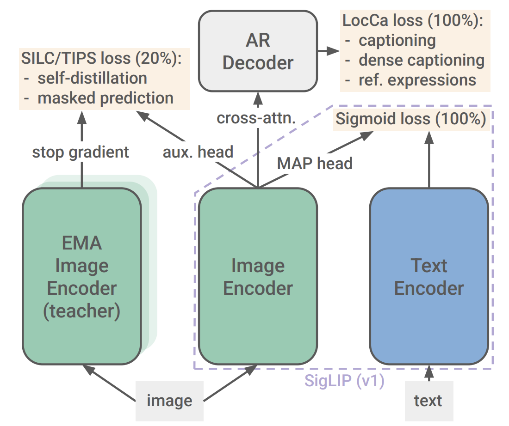
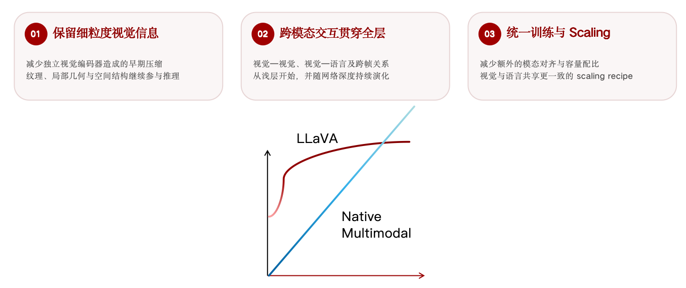

# 视觉编码器架构与多模态训练对比

**压缩口径：**总倍率按 **时间 × 高 × 宽** 排列，计算模型入口像素/时间网格到输出视觉 token 网格的名义倍率，包含 patchify；$N$ 默认指 patchify 后、末端合并前的有效 token 数。抽帧、resize 不计入网络压缩；边界 padding 按取整处理。静态图像复制时间维不算真实帧压缩；图像倍率中的时间 1 仅作占位。

**动态分辨率口径：**可变二维 patch 网格和有效 token 数，允许预算内 resize/pad。

| 模型 | 视觉模块架构 | 时空压缩、位置编码与动态分辨率 | 多模态训练 Recipe | 视觉输入 infra 优化 |
| --- | --- | --- | --- | --- |
| **MAI-Base-2** | **最大最新最强的Encoder-Free!!!** | —— | —— | —— |
| **Kimi K3** | **MoonViT-V2，401M，27 层、宽度 1024。** **Attention：MHA，Q/K/V = 12/12/12 头，每头 128 维**；按[官方公开代码](https://huggingface.co/moonshotai/Kimi-K3/blob/f831ab66814297da540d832a5235f8e904f29d06/modeling_kimi_k3.py#L603-L615)，每个 chunk 内全部 $T H W$ token 做非因果全局 attention（时空联合）。 FFN：普通两层 **GELU-tanh MLP，1024→4096→1024**；编码器末端 RMSNorm。 Projector：合并后 **4096→4096→7168，GELU，末端 RMSNorm**。 | **总倍率：$t×28×28$；满 4 帧 chunk 为 $4×28×28$。** **Patch / 压缩：**Conv2d，$1×14×14$；27 层 ViT + 末端 RMSNorm 后，对同空间位置、同通道的 $t$ 帧特征做 `mean(dim=0)`，再将空间 $2×2$ 拼到通道维，**$N→N/(4t)$**。每 chunk $1≤t≤4$；一次 forward 可打包多个 chunk，各自池化；独立图片按 $t=1$ 处理。 **位置：**64×64 可学习空间表双线性插值 + 固定时间编码；attention 内 2D RoPE，空间坐标跨帧重复。 **动态分辨率：是。** 可变 $T,H,W$ 网格、变长 patch 打包，`cu_seqlens` 隔离 chunk。最高 3584×3584。 | **MoonViT-V2 从零训练，从主模型训练开始即联合图文训练，采用自回归目标。** 视觉数据包括 caption、交错图文、OCR、感知、视频、视觉代码，以及 SVG、网页、游戏、CAD 等渲染数据。优化使用 per-head Muon， **1% warmup、cosine 调度、weight decay 0.1**。 相关后训练为 **SFT → 含视觉任务的领域专家 RL → 多教师 on-policy distillation**。 | 视觉 Context Parallelism 按图像 patch 分片、gather KV，并动态划分子组以平衡大图负载；将视觉编码器前向、反向安排进主训练流水线的空闲区间，减少视觉部分造成的等待。 |
| **Qwen3.8-Flash-Next** | **ViT，415.9M，27 层、宽度 1152。** **Attention：MHA，Q/K/V = 16/16/16 头，每头 72 维**；每个时间片内做非因果全局 attention。 FFN：普通两层 **GELU-tanh MLP，1152→4304→1152**。 Projector：LayerNorm 后空间 $2×2$ 拼接，**4608→4608→2560，GELU**。 | **总倍率：$2×32×32$；时间在 patchify 压缩 2 倍，之后不再压缩。** **Patch / 压缩：**Conv3d kernel=stride=$2×16×16$；末端 LayerNorm 后空间 $2×2$ 拼接 + MLP，**$N→N/4$**，仅额外压缩空间，无末端时间池化。 **位置：**48×48 绝对位置表双线性插值；视觉 attention 内 2D RoPE。 **动态分辨率：是。** 可变 $T,H,W$ 网格、变长 patch 打包，`cu_seqlens` 隔离 chunk。 | —— | —— |
| **DeepSeek-V4.1-Flash** | **DeepSeek-ViT，411.8M，32 层、宽度 1024。** **Attention：MHA，Q/K/V = 16/16/16 头，每头 64 维**；每张图像内做非因果全局 attention。 FFN：**SwiGLU，1024→2816→1024**；三个投影；Pre-RMSNorm 与编码器末端 RMSNorm。 Projector：空间展开后 **9216→5120→5120，GELU**；独立 aligner **73.4M**。 | **总倍率： $1×42×42$。** **Patch / 压缩：**$1×14×14$ RGB patch 展平 + Linear，588→1024；末端 `unfold(kernel=stride=3)` 做 **$3×3$ pixel-unshuffle，$N→N/9$**。不足 3 的倍数时 padding，输出空间网格为 $⌈h/3⌉×⌈w/3⌉$，按取整计算；图像前向无时间池化。 **位置：**无绝对位置表；视觉 2D RoPE，θ=10000。 **动态分辨率：是。** 按宽高和总 token 预算规划网格，通常等比 resize/pad、14 像素对齐；默认 1024 token 含分隔符。超宽图触发 `vision_max_wh_ratio` 时直接 resize。| **从零训练 DeepSeek-ViT。** ① **SigLIP 的 sigmoid 对比损失**： **47B 图文对**，alt-text，最高 224² 像素。 ② 接入**4B 辅助 LLM**，以 caption、alt-text、图表、OCR 做 **236B token 的 NTP**，分辨率 544²–1344²；随后丢弃辅助 LLM。 ③ 主模型在 **45T 全模态 token** 上训练：先冻结视觉塔，仅末端 Norm、projector 可训；进入 LR 衰减阶段再以更小 LR 解冻视觉塔。主训练 LR 为 $2.6×10^{-4}$，28T–40T 间衰减到 $2.6×10^{-5}$。 ④ **SFT→RL→OPD**，包含多模态任务。 | 对比阶段将特征 All-Gather 与计算重叠；视觉编码与主模型训练分阶段调度，并平衡图像分配、避免重复加载。多模态 RL 中增量传输图像，缓存 CPU 解码/预处理结果，供 rollout 与训练复用。 |
| **Muse Spark Open** | **Perception Encoder，1.8B，50 层、宽度 1536。** **Attention：MHA，Q/K/V = 16/16/16 头，每头 96 维**；非因果 **32×32 patch 局部窗口**；第 **4、8、…、48、50 层**为全局 attention。 FFN：普通两层 **GELU MLP，1536→8960→1536**；Pre-LayerNorm，编码器入口和末端 LayerNorm。 Projector：合并后 **6144→4096→4096→8192**，前两层后接 GELU，末端无缩放 RMSNorm。 | **总倍率：视频 $2×28×28$；静态图像 $1×28×28$。** **Patch / 压缩：**$2×14×14$ RGB 像素块展平 + Linear，**1176→1536**；末端 LayerNorm 后空间 $2×2$ pixel-unshuffle，**1536→6144，$N→N/4$**。时间在入口融合 2 帧；静态图像复制时间维。 **位置：**32×32 可学习空间表双线性插值 + 视觉 2D axial RoPE，θ=10000。 **动态分辨率：是。** 按宽高比和 token 预算 resize、28 像素对齐；变长 patch 打包，`cu_seqlens` 隔离图像/时间片，局部层另按窗口分段。 | —— | —— |
| **MiMo-V2.6-Pro** | **MiMo-ViT，681M，28 层、宽度 1280。** **Attention：GQA，Q/K/V = 32/8/8 头，每头 64 维**；24 个局部层为带 sink 的双向 SWA，一维序列左右各 64 个位置，按行/列序列化分组切换；全局层为 **[0,9,18,27]，0 基编号**。 FFN：**SwiGLU，1280→4608→1280**；块内 RMSNorm。 Projector：LayerNorm 后空间 $2×2$ 拼接，**5120→5120→6144，GELU**；独立 merger。 | **总倍率：按模型入口时间轴为 $2×32×32$；末端时间倍率为 1。** **Patch / 压缩：**Conv3d 等价投影，kernel=stride=$2×16×16$，可展开权重用 Linear 计算；末端 LayerNorm + 空间 $2×2$ 拼接 + MLP，**$N→N/4$**，无额外时间池化。`temporal_compression_ratio=1` 不应另乘一次时间倍率；入口时间块跨度由 `temporal_patch_size=2` 给出。 **位置：**无绝对位置表；视觉 2D axial RoPE。 **动态分辨率：是。** 可变网格 + `cu_seqlens` 分隔图/时间片，局部层按行列重排。有像素预算。 | ① 视觉独立预训练：ViT 从零初始化，接入小型预训练 LLM；辅助 LLM 保持可训练，仅使用多模态理解交叉熵/NTP。训练超过 **4T 图像 token**。 ② Pro 主模型先做 **27T 文本 token** 训练，再接入自研预训练 ViT，联合训练 **3T 全模态 token**；总计 30T。预训练用 AdamW。 ③ 含视觉轨迹的 mid-training：256K→1M，并切换矩阵优化器为 Muown。 ④ 短 SFT→包含视觉任务的混合任务 RL，得到 **Pro-RL**；再经 MOPD2 得到 **Pro-MOPD**。 | 视觉编码器在 TP 组内复制，先按图像做数据并行负载均衡，再把 embedding 重分发到对应 token 所在 rank；像素留在分布式 KV 存储，仅在编码时获取。多轮任务只传新增的多模态 payload。 |
| **Thinking Machines Inkling** | **HMLP，83.74M，4 级局部折叠与线性投影，输出宽度 6144。** 局部投影：HMLP 前三级为 **75→128、512→320、5120→4800**，各级使用 **Linear→RMSNorm→GELU**。 Projector：HMLP 最后一级为 **9600→6144，末端 RMSNorm**。 | **总倍率：视频 $2×40×40$；静态图像 $1×40×40$。** **Patch / 压缩：**HMLP 前三级依次将空间 $5×5$、$2×2$、$4×4$ 邻域拼到通道维，每级再接线性投影，空间网格 $40×40→8×8→4×4→1×1$；第四级拼接两个时间位置，投影为 6144 维的 1 个 token。静态图像复制时间维，不计真实帧压缩。 **位置：**HMLP 内无绝对位置表/RoPE、无 patch 间 attention。 **动态分辨率：是。** 按输入宽高切 40×40 块，边缘 padding；可选等比 Lanczos 重缩放，官方建议每边 40–4096 像素。 | ——  | —— |
| **GLM-5.3-Flash** | **ViT，404.2M，24 层、宽度 1024。** **Attention：MHA，Q/K/V = 16/16/16 头，每头 64 维**；空间网格内做非因果全局 attention；逐头 **QK RMSNorm**。 FFN：**SwiGLU，1024→4096→1024**，带 bias；**gate 仅上界裁剪至 10，up 裁剪至 [-10,10]**；Pre-RMSNorm 与编码器末端 RMSNorm，$\epsilon=10^{-5}$。 Projector：空间卷积后 **4096→4096，LayerNorm+GELU，再接中间维 10240 的 clipped SwiGLU→4096**；独立 Projector 与末端空间卷积合计 **159.4M**。 | **总倍率：按模型入口时间轴为 $2×28×28$；patchify 后时间倍率为 1。** **Patch / 压缩：**Conv3d kernel=stride=$2×14×14$；末端 **Conv2d，1024→4096，kernel=stride=2**，将高宽各减半，**$N→N/4$**；无额外时间池化。空间压缩使用有学习参数的卷积。 **位置：**无绝对位置表；视觉 2D axial RoPE。 **动态分辨率：是。** `smart_resize` 按预算选画布，等比 bicubic resize + 右/下 padding，28 像素对齐；变长 patch + `cu_seqlens` 隔离图/时间片。静态图像在入口复制时间维；部署端可覆盖预算。 | —— | —— |
| **dots3-note-prev** | **MoE ViT，7B 总参数、1.2B 激活参数，42 层、宽度 1536。**发布实现估算 **6.80B / 单 token 激活 1.216B**。 **Attention：MHA，Q/K/V = 24/24/24 头，每头 64 维**；每帧内做非因果全局 attention；**QK RMSNorm**。 FFN：前 **25 层 dense SwiGLU，1536→4224→1536**；后 **17 层视觉 MoE**，专家数依次 **4,8,…,64,64**，**Top-2**，每专家 **1536→2112→1536 SwiGLU**；Pre-RMSNorm 与编码器末端 RMSNorm。 Projector：LayerNorm 后空间 $2×2$ 拼接，**6144→6144→5120，GELU**；独立 adapter 另 **69.2M**。 | **总倍率：$1×28×28$；时间不压缩。** **Patch / 压缩：**Conv2d，$1×14×14$；前置 `pre_pixel_shuffle` 仅作 $2×2$ block-major 重排，token 数不变。42 层之后 adapter 才做空间 $2×2$ 拼接，**$N→N/4$**；图像/视频逐帧编码，无时间池化。 **位置：**无可学习绝对位置表；视觉 2D axial RoPE，空间坐标逐帧重复。 **动态分辨率：是。** 可变 `grid_thw`、变长 patch 和 `cu_seqlens` 分隔图/时间片。 | —— | —— |

<!-- vit-details -->

## SigLIP 2

要说近两年影响力最大的vision encoder，当之无愧是 SigLIP 2，SigLIP 2充分展现了视觉学习的现代经典思路：究极缝合怪，集百家之长。（关于这点可以稍稍参考我之前的blog “从 VAE 到 RAE：既要又要的生成latent表征”）

下面我们以用的最多的 So400m 版本聊一聊

### 1. 架构

- 标准 ViT，视觉塔约 400M，27 层、Hidden 1152。

- Attention：MHA，Q/K/V = 16/16/16 Heads，Head Dim 72；非因果全局 Attention。

- FFN：GELU，1152→4304→1152；LayerNorm，Multihead Attention Pooling（用一个 Learnable Query 在最后一层对所有 Patch 做 Cross-Attention，代替 Mean Pooling 或 CLS Token）。

- Text Encoder： 同样 27 层、Hidden 1152；文本长度 64，Gemma 256K Tokenizer。

- 训练期使用 LocCa Decoder、EMA Teacher 和辅助 Head，最终全部丢弃。

### 2. Patch / 分辨率 / 位置编码

- Patch： 初始预训练使用 16×16，256² 图像，256 Visual Tokens；不压缩 Patch Tokens。

- 固定分辨率： Patch14 支持 224²、384²；Patch16 支持 256²、384²、512²。

- 位置编码： Learned Absolute Position Embedding，不使用 RoPE。

- 动态分辨率：NaFlex，尽量保持原始宽高比；通过双线性插值适配位置编码，支持 128/256/576/784/1024 Token Budget。

### 3. 训练方法

下面简单聊聊SigLIP2千奇百怪的loss们：

#### ① SigLIP + LocCa（全程训练，Loss 1:1）

- Sigmoid Loss： Batch 内所有图文 Pair 独立进行二分类，匹配为正样本，其余为负样本。

- LocCa： 在 ViT 的 Patch Features 上增加 Cross-Attention Decoder，执行三个生成任务：

    - Image → Caption：生成整图描述。

    - Region Caption → BBox：根据区域描述预测坐标。

    - BBox → Region Caption：根据坐标生成区域描述。

- 训练数据： 从 Alt-Text 提取词组，用 Open-Vocabulary Detector 自动生成 Region-BBox 伪标签。

- 训练方式： 每张图像共享一次 ViT Forward，额外执行 3 次 Decoder Forward；Captioning 有 50% 概率使用非因果并行 Token Prediction。

- Decoder 仅用于训练，推理时丢弃。

#### ② SILC / TIPS（最后 20% 加入）

采用 DINO/iBOT 风格的 EMA Teacher-Student 自监督：

- SILC（Loss 权重 1.0）： Teacher 看 1 个 Global View，Student 看 8 个 Local Views，通过额外 MLP Head 匹配全局语义分布，增强局部与全局表征一致性。

- TIPS（Loss 权重 0.25）： Teacher 看完整 Global View，Student 随机 Mask 50% Patch Embeddings，预测对应位置的 Teacher Features，不是重建 RGB。

- Teacher 由 Student 的 EMA 更新，不反传梯度；SigLIP/LocCa 仍使用原始图像，自监督额外使用增强图像。

So400m 最后 20% 的总 Loss：

$$
\mathcal{L}=\mathcal{L}_{\mathrm{SigLIP}}+\mathcal{L}_{\mathrm{LocCa}}+\mathcal{L}_{\mathrm{SILC}}+0.25\mathcal{L}_{\mathrm{TIPS}}
$$

#### ③ 分辨率适配（两条独立分支）

FixRes： 从 95% 训练进度的 Checkpoint 分叉。

- 提高图像分辨率，对 Learned Position Embedding 进行 2D 插值，例如 16×16 → 24×24。

- Patch16 → Patch14 时，通过 PI-Resize（Pseudoinverse） 转换 Patch Embedding 权重，尽量保持投影结果一致。

- 在目标分辨率继续剩余 5% 训练，保留全部 Loss；不同分辨率分别保存 Checkpoint。

NaFlex： 从 90% Checkpoint 分叉。

- 尽量保持原始宽高比，Resize 至 Patch Size 整数倍，不强制正方形。

- 每个 Batch 从 `{128, 256, 576, 784, 1024}` 采样 Token Budget。

- 对 16×16 Learned PE 双线性插值到目标 Patch Grid，Attention Mask 屏蔽 Padding。

- 训练末段 LR Schedule 延长 3.75 倍；不使用 SILC/TIPS，仅保留 SigLIP + LocCa。

#### ④ ACID：小模型的数据筛选蒸馏

So400m 后面可以作为 ViT-B 的 Teacher进行 ACID 蒸馏

- So400m 先在高质量数据上额外训练 1B 样本。

- Teacher 与 Student 为候选样本计算 Learnability，优先选择 Teacher 已掌握、Student 尚未掌握 的样本。

- 从 64K Super-batch 筛选 32K，Student 继续训练 4B 样本。

- 只使用 Sigmoid Loss，不直接蒸馏 Teacher Logits / Features。

## Perception Encoder（PE-G）

不同于 SigLIP 2 组合多种预训练 Loss， Perception Encoder（PE）主要依靠大规模 CLIP Contrastive Learning，发现强大的通用视觉特征隐藏在中间层，再通过 Alignment Tuning 将这些能力迁移到输出层。

### 1. 架构

- 标准 ViT，视觉塔 1.88B，50 层、Hidden 1536。

- Attention：MHA，Q/K/V = 16/16/16 Heads，Head Dim 96；非因果全局 Attention。

- FFN：1536→8960→1536；8 Heads Attention Pooling，不使用 CLS Token。

- Text Encoder：0.47B，24 层、Hidden 1280；20 Heads，FFN 5120，文本长度 72；图文对比维度 1280。

### 2. Patch / 分辨率 / 位置编码

- Patch：14×14，最终 448² 图像对应 1024 Visual Tokens，不压缩 Patch Features。

- 位置编码：2D RoPE + Learned Absolute PE，后者支持插值。

- Progressive Resolution：98²→154²→224²→336²→448²。

### 3. 训练方法

#### ① CLIP Contrastive Pretraining

- Loss：传统 CLIP 双向 Softmax Contrastive Loss，而非 SigLIP 的 Sigmoid Loss。

- 数据：MetaCLIP 筛选的 5.4B Image-Text Pairs，累计 86B Samples Seen。

- 优化：LAMB，Batch Size 131K，LR 2e-3，训练 656K Steps。

- Augmentation：Random Crop（0.08–1.0）、Color Jitter、Horizontal Flip。

- Mask Regularization：额外复制 1/16 Batch，随机 Mask 40% Patches，对齐 Masked/Unmasked Features 的 Cosine Similarity；与 CLIP Loss 的梯度路径分离。

#### ② Video Finetuning

- 先使用 50M Images 做 Cooldown，再使用 22M Recaptioned Videos 微调。

- 视频 Caption：结合 Video Captioner、Frame Captions 和 Metadata，再由 Llama 3.3 70B 整合。

- 每个视频均匀采样 8 Frames，分别经过相同 ViT，Mean Pooling 得到 Video Embedding。

- 继续使用 CLIP Contrastive Loss，不增加 Temporal Attention。

#### ③ Intermediate Layer：

PE-G 的最佳视觉特征不一定在最后一层：

- OCR：第 38 层；VQA：第 47 层。

- Detection / Depth：第 39 层；Tracking：第 32 层。

- 从第 33 层开始出现 Global Tokens，后面 18 层逐渐承担全局语义聚合，导致部分局部空间信息丢失。

因此，作者从 PE-core-G 分叉出两种 Alignment：

- PE-lang-G：保留前 47 层，丢弃最后 3 层；连接 Llama 3.2 3B + MLP Projector，使用 70M 多模态样本通过 CE Loss 联合微调，增强 OCR/VQA 等语言理解能力。

- PE-spatial-G：同时蒸馏 Frozen PE-core-G 第 41 层的语义特征与 SAM 2.1 的 Mask Logits 空间对应关系；使用 75% Masking，训练 300M Samples，使最后一层具备更强的 Dense Features。

## Encoder-Free

最后顺便推销在我们力推的Encoder-Free吧！非常令人振奋的是，在我写这篇blog的时候，微软发布了他们最新的3T模型 MAI-Base-2，正是 Encoder Free VLM！

Encoder Free的核心就是去掉独立的深层视觉编码器，改用轻量的patchify 投影输入，可以参考 NEO NEO-ov， SenseNova-U1，SenseNova-U1.5，Gemma4-12B，Inking（建议考古 Haiwen Diao的publication list，原生建模的老大哥）

这会有什么好处呢？

此外，我之前也有篇 Blog "为什么我们想拿掉 Vision Encoder？"(可以在主页搜hh)也有提及 Infra 的一些小小小小小小好处。
归根结底，我一向的taste是 "removing inductive bias as much as possible to let the model architecture take its natural and intended form"，如果去除它也可以，那 Why not?

